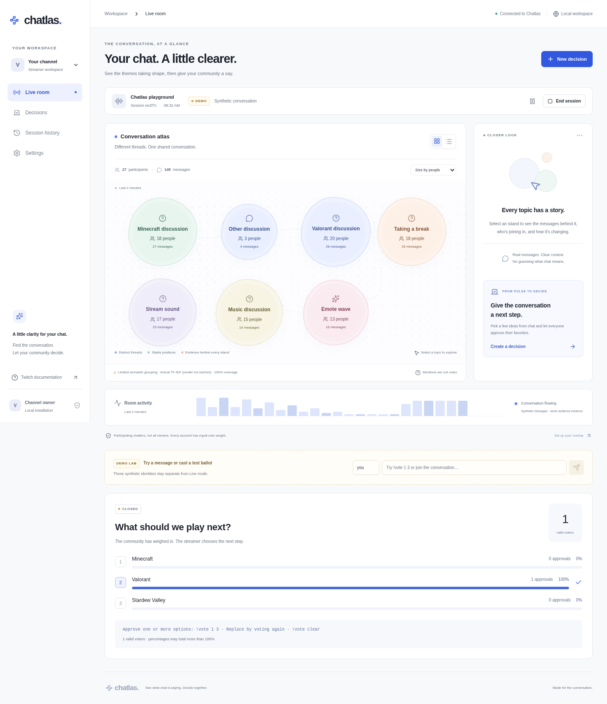

# Chatlas

**See what chat is saying. Decide together.**

Chatlas is a Twitch companion with two connected modes: **Pulse**, a stable topic atlas with inspectable message evidence, and **Decide**, explicit approval voting through ordinary chat. Viewers need no companion account. This repository was built from the supplied [technical specification](SPEC.md).



## Run locally

Requires **Node 24 LTS** (verified with 24.19.0) and npm. SQLite is built into Node; no database service is required.

macOS/Linux:

```sh
nvm use                       # if you use nvm
ONNXRUNTIME_NODE_INSTALL=skip npm ci
cp .env.example .env           # only for a fresh checkout; preserve existing .env
npm run secrets:init
npm run dev
```

Windows PowerShell:

```powershell
$env:ONNXRUNTIME_NODE_INSTALL = 'skip'
npm ci
if (!(Test-Path .env)) { Copy-Item .env.example .env }
npm run secrets:init
npm run dev
```

Open the development frontend on port **5173**. Vite proxies `/api`, `/auth`, and `/ws` to Fastify on **3001**. Use the hostname in `APP_ORIGIN` consistently: `localhost` and `127.0.0.1` are different origins. No Twitch credentials are needed for Demo. Generated local secrets are appended to ignored `.env`, never printed. The ONNX setting skips optional GPU downloads; verified CPU binaries remain included in the integrity-checked npm package.

The initial Demo contains synthetic messages and keeps generating them until paused. Select a topic to inspect private evidence. Choose **New decision**, edit options, publish, then use the Demo lab to send `!vote 1 3`, followed by `!vote 2`. The voter count stays at one. Close the vote and refresh; the result persists.

## Commands

| Command                              | Purpose                                                     |
| ------------------------------------ | ----------------------------------------------------------- |
| `npm run dev`                        | Start Fastify and Vite with reload                          |
| `npm run build`                      | Build the frontend and check server types                   |
| `npm start`                          | Serve production frontend and API from Fastify              |
| `npm run lint` / `npm run typecheck` | Static checks                                               |
| `npm test`                           | Database, auth, worker, transport, and replay tests         |
| `npm run test:e2e`                   | Playwright browser acceptance                               |
| `npm run test:load`                  | Bounded synthetic SQLite/worker load, writes actual results |
| `npm run evaluate`                   | Small synthetic lexical grouping evaluation                 |
| `npm run model:download`             | Download and exercise the optional MiniLM CPU model         |
| `npm run secrets:init`               | Generate only missing local secrets                         |

Install a browser with `npx playwright install chromium`. If Chromium is already installed, set `PLAYWRIGHT_CHROMIUM_EXECUTABLE` to its path. Tests use a separate in-memory or temporary database except browser tests, which operate on the local Demo database and reset the Demo. Do not run browser tests against an active Live session.

Production: `npm run build`, set `NODE_ENV=production`, `APP_ORIGIN=https://your-host`, `SESSION_SECRET`, and a **64-character hexadecimal** `TOKEN_ENCRYPTION_KEY`, then `npm start`. The backend defaults to port 3001. Keep `.env` private. Production rejects missing secrets and non-HTTPS public origins. See [deployment](docs/DEPLOYMENT.md).

## Twitch and OBS

Follow [TWITCH_SETUP.md](TWITCH_SETUP.md) to register a Confidential Twitch application and authorize the owner. Only that owner's channel is ingested. [OBS_SETUP.md](OBS_SETUP.md) covers the read-only Browser Source. Credentials are exchanged server-side; tokens are encrypted with AES-256-GCM.

Twitch app credentials were not available during this build. OAuth and EventSub have automated simulated coverage, but **real Twitch and actual OBS acceptance are pending**. Current official documentation could not be retrieved under the cloud network policy; confirm the documented scopes and subscription requirements before Live acceptance. No real Twitch connection is claimed.

## Analysis and interpretation

The worker tries cached `Xenova/all-MiniLM-L6-v2` q8 weights (384-dimensional, Apache-2.0 model card license). `npm run model:download` discloses approximately 23 MB of weights plus tokenizer/configuration files and reports download progress. Inference runs in a worker with batches of 16, a bounded text cache, and a per-update inference budget. Remote model downloads never occur silently on server startup.

When weights are missing, the dashboard explicitly says **Limited semantic grouping · lexical TF-IDF**. The cloud model download was blocked; cached-model inference has not been validated here. Use `EMBEDDING_MODEL=lexical` to deliberately select the fallback. Restart after downloading weights. Semantic assignment uses the specification's **0.72 experimental threshold**; lexical assignment uses a separate heuristic. Neither is a validated universal threshold. English is the supported default; no sarcasm or sentiment inference is claimed.

Topic counts show messages and distinct contributors over 120 seconds. Repetition is `(messages − contributors) / messages`, not proven spam. Contributor share uses all distinct active participants; people can discuss multiple topics. Labels are constrained neutral defaults or explicitly owner-approved. Commands stay outside clustering. A topic normally needs three distinct contributors. Pin, rename, hide, merge, and evidence split are available in the inspector. Manual lineage is audited.

Topic mentions are **not votes**. Approval votes count each Twitch account's latest complete valid ballot. Repeating a vote adds no weight; malformed commands change nothing. `!vote clear` removes the account from the denominator. Ties stay ties, and zero votes produce no winner. This is fairness per account, not proof of human uniqueness or audience representativeness.

## Replay and data

Settings accepts timestamped JSONL. Bundled fixtures are synthetic and must use DEMO. Recordings with participant consent use REPLAY. Pause/resume and 0.25×–4× speeds are supported. Starting an import creates a separate session; it never targets a Live decision. See [fixture provenance](fixtures/README.md).

Raw messages expire after **24 hours**; active memberships expire after **120 seconds**. Expired raw text and in-worker vectors are not retained as long-term audience profiles. Vote revisions stay until session deletion. Delete session data from Session history to cascade-delete its messages, votes, topics, and replay events. Closed results remain frozen after moderation; open ballots roll back deleted revisions. No audio, video, private messages, IP identity profiles, paid influence, or automatic stream control is collected or implemented.

## Validation and remaining acceptance

Latest automated checks: **18 server tests and 2 browser tests passed**, plus production process/restart smoke, type checking, lint, and build. Clean lockfile installation was repeated successfully.

Actual measurements are in [LOAD_RESULTS.json](docs/LOAD_RESULTS.json) and [EVALUATION_RESULTS.json](docs/EVALUATION_RESULTS.json). The latter is a tiny Codex-authored synthetic set, **not** the required independent human-labeled evaluation. No general accuracy, frame-rate, Twitch-latency, or audience-impact claims follow from it.

Before a public release: complete real Twitch/OBS acceptance with consenting participants; verify the cached model on target hardware; perform independent human-labeled semantic/lexical evaluation and longer load/visual performance tests; review the documented operational restrictions. Optional outgoing chat writes are not enabled in this build. `!chatlas` is reserved as a help command and excluded from clustering; no bot response is sent without an outgoing-write implementation and explicit opt-in.

Architecture: [docs/ARCHITECTURE.md](docs/ARCHITECTURE.md). Actual contributions, checks, and limitations: [BUILD_LOG.md](BUILD_LOG.md). Suggested recording: [docs/DEMO_SCRIPT.md](docs/DEMO_SCRIPT.md). Obtain the main Codex thread session ID using `/status`; no ID or hackathon submission status has been invented.
